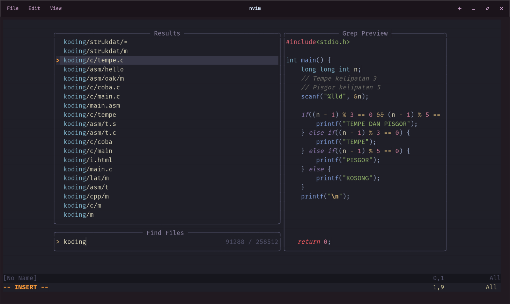
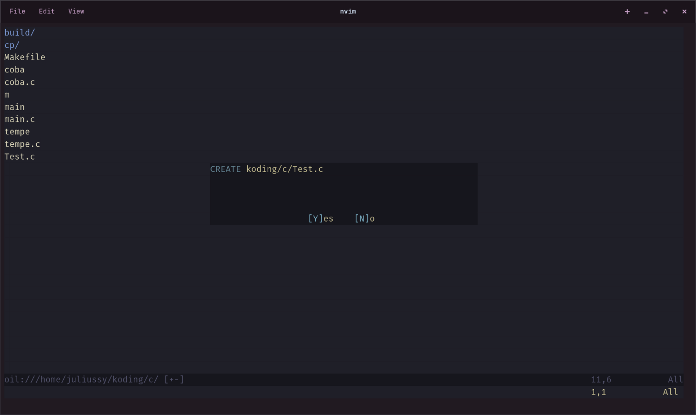

# Neovim Configuration

A personal Neovim configuration built from scratch using `lazy.nvim`.

The goal of this setup is to build a lightweight development environment while understanding every component instead of using a preconfigured distribution.



---

# Table of Contents

* [Features](#features)
* [Installation](#installation)
* [Plugin Stack](#plugin-stack)
* [Keybindings](#keybindings)
* [Workflow](#workflow)
* [Project Structure](#project-structure)
* [Development Setup](#development-setup)
* [Future Improvements](#future-improvements)
* [References & Sources](#references--sources)

---

# Features

* Plugin management with `lazy.nvim`
* Modern syntax highlighting with Tree-sitter
* File navigation and fuzzy searching
* Integrated terminal
* Language Server Protocol support
* Autocomplete and code suggestions
* Custom keybindings
* Modular Lua configuration

---

# Installation

Clone this configuration:

```bash
git clone <repository-url> ~/.config/nvim
```

Open Neovim:

```bash
nvim
```

Install plugins:

```vim
:Lazy sync
```

Install development tools:

```vim
:Mason
```

---

# Plugin Stack

## Core

| Plugin          | Purpose                         |
| --------------- | ------------------------------- |
| lazy.nvim       | Plugin manager                  |
| nvim-treesitter | Syntax parsing and highlighting |
| Tree-sitter CLI | Parser management               |

---

## Editor Experience

| Plugin          | Purpose                              |
| --------------- | ------------------------------------ |
| Telescope.nvim  | Fuzzy finding and project search     |
| Oil.nvim        | File explorer and filesystem editing |
| ToggleTerm.nvim | Integrated terminal                  |
| Kanagawa.nvim   | Colorscheme                          |

---

## Development Environment

| Plugin            | Purpose                            |
| ----------------- | ---------------------------------- |
| Mason.nvim        | Install and manage developer tools |
| nvim-lspconfig    | Configure Language Servers         |
| blink.cmp         | Autocomplete engine                |
| friendly-snippets | Snippet collection                 |

---

# Keybindings

Leader key:

```text
Space
```

---

## General

| Shortcut   | Action                 |
| ---------- | ---------------------- |
| `Space ff` | Find files             |
| `Space fg` | Search text in project |
| `Space fb` | Find open buffers      |
| `Space tt` | Toggle terminal        |
| `-`        | Open Oil file explorer |

---

## LSP

| Shortcut   | Action             |
| ---------- | ------------------ |
| `gd`       | Go to definition   |
| `K`        | Show documentation |
| `Space rn` | Rename symbol      |
| `Space ca` | Code action        |

---

## Completion

| Shortcut | Action                      |
| -------- | --------------------------- |
| `Tab`    | Select/accept completion    |
| `Enter`  | Confirm selected suggestion |
| `Ctrl-y` | Accept suggestion           |

---

## Tree-sitter

| Command                 | Action                   |
| ----------------------- | ------------------------ |
| `:TSUpdate`             | Update installed parsers |
| `:TSInstall <language>` | Install parser           |

Example:

```vim
:TSInstall lua
```

---

## Lazy.nvim

| Command        | Action                 |
| -------------- | ---------------------- |
| `:Lazy`        | Open plugin manager    |
| `:Lazy sync`   | Install/update plugins |
| `:Lazy update` | Update plugins         |
| `:Lazy clean`  | Remove unused plugins  |

---

## Mason

| Command                | Action        |
| ---------------------- | ------------- |
| `:Mason`               | Open Mason UI |
| `:MasonInstall <tool>` | Install tool  |

---

# Workflow

Typical development workflow:

```text
Open project
      |
      v
Oil.nvim (-)
      |
      v
Telescope search
      |
      v
Edit code with Tree-sitter
      |
      v
LSP navigation
      |
      v
Autocomplete with blink.cmp
      |
      v
Terminal with ToggleTerm
      |
      v
Run / test / debug
```

---

# Project Structure

```text
~/.config/nvim
│
├── init.lua
│
└── lua
    │
    ├── config
    │   ├── options.lua
    │   └── lazy.lua
    │
    └── plugins
        ├── colorscheme.lua
        ├── treesitter.lua
        ├── telescope.lua
        ├── oil.lua
        ├── toggleterm.lua
        ├── mason.lua
        ├── lsp.lua
        └── blink.lua
```

---

# Development Setup

## Supported Languages

Installed through Mason:

| Language                | Language Server |
| ----------------------- | --------------- |
| Lua                     | lua_ls          |
| JavaScript / TypeScript | ts_ls           |
| Python                  | pyright         |
| C / C++                 | clangd          |

---

## Formatting

Current indentation:

```text
tabstop = 2
shiftwidth = 2
expandtab = true
```

Neovim uses 2 spaces by default.

---

# Future Improvements

Possible additions:

* Debug Adapter Protocol (DAP)
* Git integration
* Statusline customization
* Code formatting
* Testing integration
* Project management tools
* Better terminal workflows

---

# References & Sources

## Core Technologies

| Technology      | Purpose                                 | Source                                     |
| --------------- | --------------------------------------- | ------------------------------------------ |
| Neovim          | Text editor and development environment | https://github.com/neovim/neovim           |
| lazy.nvim       | Plugin manager                          | https://github.com/folke/lazy.nvim         |
| Lua             | Configuration language                  | https://www.lua.org/                       |
| Tree-sitter     | Syntax parsing framework                | https://tree-sitter.github.io/tree-sitter/ |
| Tree-sitter CLI | Parser management                       | https://github.com/tree-sitter/tree-sitter |

---

## Neovim Plugins

| Plugin            | Purpose                 | Source                                             |
| ----------------- | ----------------------- | -------------------------------------------------- |
| nvim-treesitter   | Tree-sitter integration | https://github.com/nvim-treesitter/nvim-treesitter |
| Kanagawa.nvim     | Colorscheme             | https://github.com/rebelot/kanagawa.nvim           |
| Telescope.nvim    | Fuzzy finder            | https://github.com/nvim-telescope/telescope.nvim   |
| Plenary.nvim      | Lua utility library     | https://github.com/nvim-lua/plenary.nvim           |
| Oil.nvim          | File explorer           | https://github.com/stevearc/oil.nvim               |
| ToggleTerm.nvim   | Terminal integration    | https://github.com/akinsho/toggleterm.nvim         |
| Mason.nvim        | Tool installer          | https://github.com/mason-org/mason.nvim            |
| nvim-lspconfig    | LSP configuration       | https://github.com/neovim/nvim-lspconfig           |
| blink.cmp         | Completion engine       | https://github.com/Saghen/blink.cmp                |
| friendly-snippets | Snippet collection      | https://github.com/rafamadriz/friendly-snippets    |

---

## Language Servers

| Language                | Server                     | Source                                                                   |
| ----------------------- | -------------------------- | ------------------------------------------------------------------------ |
| Lua                     | Lua Language Server        | https://github.com/LuaLS/lua-language-server                             |
| TypeScript / JavaScript | TypeScript Language Server | https://github.com/typescript-language-server/typescript-language-server |
| Python                  | Pyright                    | https://github.com/microsoft/pyright                                     |
| C / C++                 | clangd                     | https://clangd.llvm.org/                                                 |

---

## CLI Tools

| Tool     | Purpose              | Source                                |
| -------- | -------------------- | ------------------------------------- |
| Git      | Version control      | https://git-scm.com/                  |
| ripgrep  | Fast text searching  | https://github.com/BurntSushi/ripgrep |
| Cargo    | Rust package manager | https://doc.rust-lang.org/cargo/      |
| LuaRocks | Lua package manager  | https://luarocks.org/                 |

---

# Philosophy

Keep the configuration simple.

Add plugins only when they solve a real problem.

Understand every layer before adding more complexity.
